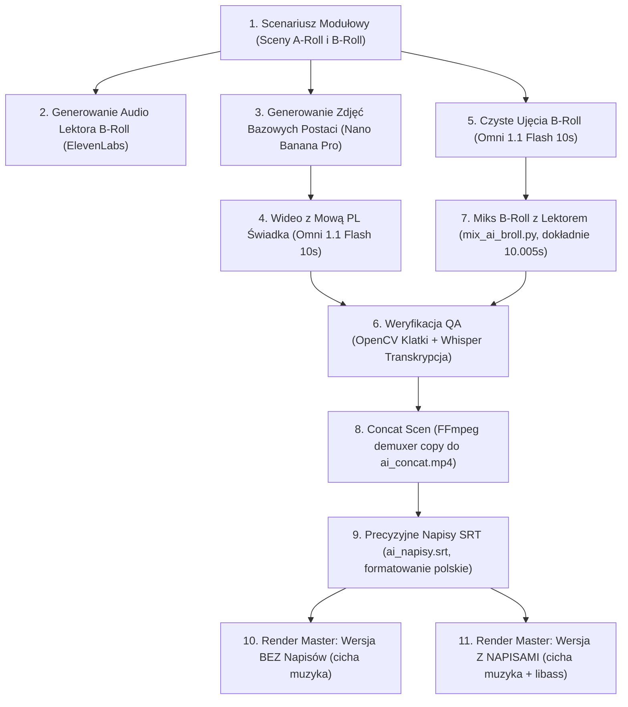

# INSTRUKCJA PRODUKCJI FILMÓW HISTORYCZNYCH I DOKUMENTALNYCH
### Sprawdzony standard: Świadek Dziejów (Omni Flash PL) + B-Roll (ElevenLabs) + Subtelna Muzyka Tła + Dwie Wersje (Z Napisami i Bez)

---

## 1. Wstęp i Architektura Formatu

Format minidokumentu opiera się na **naprzemiennym łączeniu dwóch typów scen**:
1. **Sceny Fabularne ze Świadkiem Dziejów (A-Roll – Sceny nieparzyste)**:
   * Postać historyczna / świadek epoki zwraca się bezpośrednio do kamery w pierwszej osobie.
   * Model wideo (**Omni 1.1 Flash**) generuje **jednocześnie obraz, mimikę, zsynchronizowany ruch warg (lip-sync) oraz czysty głos w języku polskim**.
2. **Sceny Nastrojowe / Kontekstowe (B-Roll – Sceny parzyste)**:
   * Ujęcia otoczenia, architektury, rzemiosła, technologii, detali lub panoramy bez postaci mówiącej.
   * Ścieżka dźwiękowa składa się z:
     - Lektora w języku polskim (ElevenLabs, np. profil *George* / *eleven_multilingual_v2* z normalizacją `loudnorm` do -16 LUFS),
     - Cichego ambientu tła wygenerowanego z wideo (odgłosy kuźni, serwerowni, szumu morza – głośność ~8-15%),
     - Delikatnej muzyki przewodniej w tle (dyskretny podkład -24 dB).

### Skalowalność formatu:
- **Standardowy format**: 14 scen × 10.01 s = **140 sekund** (2:20 min).
- **Format rozszerzony / Epicki**: 28 scen × 10.01 s = **280 sekund** (4:40 min), podzielony na 4 zrównoważone akty tematyczne.

---

## 2. Kluczowe Zasady i Wyciągnięte Wnioski (Czego Unikać – Postmortem)

### ❌ Błąd 1: Nakładanie się lektora na mowę postaci
* **Co poszło nie tak**: Wcześniejsze próby nakładały głos lektora ElevenLabs na ujęcia, gdzie postać już poruszała ustami. Powstawała kakofonia dwóch nakładających się głosów.
* **Żelazna zasada**: **Świadek mówi SAM na swoich scenach**. Ścieżka z Omni Flash ma doskonały lip-sync. Lektor ElevenLabs występuje **WYŁĄCZNIE na ujęciach B-Roll**.

### ❌ Błąd 2: Blokady filtrów bezpieczeństwa Google Flow („Prominent People”)
* **Co poszło nie tak**: Wpisywanie do promptów nazwisk znanych postaci historycznych (np. „Alan Turing”) powoduje natychmiastowe odrzucenie generowania przez filtr Google Flow.
* **Żelazna zasada obejścia**: Postać w promptach wideo **zawsze opisujemy neutralnie** (np. *„Standing in the 1939 British intelligence hut, the charismatic researcher speaks aloud in Polish: ...”*). Konkretne nazwiska i fakty historyczne wypowiada lektor ElevenLabs w scenach B-Roll.

### ❌ Błąd 3: Ucinająca się, „falująca” lub zanikająca muzyka w tle
* **Co poszło nie tak**: 
  1. Stosowanie utworów ze spadkami do ciszy (np. `Modal Motif.mp3` posiadający naturalne pauzy) oraz naiwne pętlenie `-stream_loop -1` powodujące nagłe urwanie i restart.
  2. Używanie filtru `dynaudnorm` na muzyce, który w momentach ciszy agresywnie podbijał szum i ciche dźwięki, a przy uderzeniach gwałtownie ściszał tło („pompowanie”).
  3. Zbyt niski poziom (`volume=0.025`, czyli -32 dB) powodujący, że przy przerwach w mowie lektora widz słyszał martwą ciszę.
* **Żelazna zasada miksowania muzyki (Broadcast Standard)**:
  1. **Jednolity podkład o stabilnej dynamice**: Wybieraj utwory o stałej energii (np. `Królestwo Cienia` lub `Archive Motif`) i przygotuj master o pełnej długości filmu z miękkim miksem krzyżowym (`acrossfade=d=8`).
  2. **Sidechain Ducking zamiast dynaudnorm**:
     Muzyka gra wyjściowo na stabilnym poziomie `volume=0.085`, a gdy pojawia się dialog/lektor, filtr `sidechaincompress` łagodnie przycisza tło o 3-4 dB (do bezpiecznego poziomu ok. -22 dB). W momentach pauzy muzyka płynnie wypełnia przestrzeń:
     ```text
     [1:a]volume=0.085,afade=t=in:st=0:d=2.5,afade=t=out:st=X:d=5[music_raw];
     [0:a]volume=1.0,aresample=48000,aformat=sample_fmts=fltp:channel_layouts=stereo[dialogue];
     [music_raw][dialogue]sidechaincompress=threshold=0.025:ratio=2.5:attack=150:release=600[music_ducked];
     [dialogue][music_ducked]amix=inputs=2:duration=first:weights=1 1:normalize=0[aout]
     ```

### ❌ Błąd 4: Brak polskiego tekstu w cudzysłowie w prompcie Omni Flash
* **Co poszło nie tak**: Jeśli w prompcie wideo napisano jedynie ogólnie *„he talks about AI”*, model mówił po angielsku lub generował przypadkowe dźwięki.
* **Przełomowa zasada promptowania**: W prompcie Omni 1.1 Flash **ZAWSZE podajemy dosłowną kwestię dialogową w języku polskim w cudzysłowie**:
  ```text
  ...speaks aloud in Polish: "Treść wypowiedzi w cudzysłowie..." with natural expressive Polish lip movement.
  ```

### ❌ Błąd 5: Zapisywanie liczb i dat cyframi (`740`, `1956`, `2026`)
* **Co poszło nie tak**: Cyfry w promptach mowy powodują zniekształcenia fonetyczne lub odczytywanie po angielsku.
* **Żelazna zasada fonetyczna**: **NIGDY nie używaj cyfr w promptach dialogowych**. Zapisuj każdą liczbę i datę **w 100% słownie**:
  - Zamiast `1896` -> wpisz `tysiąc osiemset dziewięćdziesiątego szóstego`.

### ❌ Błąd 6: Zapętlanie pojedynczego klipu B-Roll (`-stream_loop -1`) pod dłuższy głos lektora
* **Co poszło nie tak**: Gdy mowa lektora ElevenLabs trwała 14–16 sekund, a wideo z generatora miało 10 sekund, zapętlenie wideo powodowało nienaturalny powrót do początku ujęcia, skok kamery lub zamrożenie obrazu.
* **Żelazna zasada Multi-Shot B-Roll**:
  - Nigdy nie zapętlaj obrazu.
  - Dla każdej sceny B-roll trwającej > 9.5 s wygeneruj **dwa unikalne ujęcia** (Shot A: plan ogólny/panorama, Shot B: detal/plan bliski).
  - Połącz oba ujęcia w jedną sekwencję (np. 8s + 7s) i przytnij łączne wideo co do klatki pod czas trwania lektora: `t = lektor_dur + 0.8s`.

### ❌ Błąd 7: Przeładowanie prompta tekstem (>20 słów na 10s) i ucinanie zdań na granicy 10.0s
* **Co poszło nie tak**: W klipach 10-sekundowych wpisanie zbyt długiej kwestii (25–28 słów) skutkowało tym, że model Flow ucinał mowę w połowie słowa lub zdania dokładnie na klatce 240 (10.00s).
* **Żelazna zasada Budżetu Słów**:
  - Każda kwestia mówiona musi liczyć **maksymalnie 15–18 słów** w języku polskim.
  - Aktor musi skończyć wypowiedź w 7,5–8,5 sekundy, co gwarantuje 1,5 sekundy naturalnej pauzy i oddechu przed montażowym cięciem.

### ❌ Błąd 8: Dryf wizerunku postaci przez generowanie z czystego tekstu bez kotwicy
* **Co poszło nie tak**: Od pewnego momentu postać Świadka Dziejów oraz Nikoli Tesli była generowana wyłącznie z opisu tekstowego. Model losował inne ziarno (seed), zmieniając anatomię twarzy, fryzurę i wiek.
* **Żelazna zasada Kotwicy Wizualnej (`Początek` / Start Frame)**:
  - Do każdego ujęcia A-Roll ze Świadkiem obowiązkowo podpinamy stałą klatkę referencyjną `Początek` z pliku `swiadek_dziejow.jpg`.
  - Dla powracających bohaterów (np. Nikola Tesla) stosujemy stały kadr referencyjny jako `Początek`, zapewniając 100% spójności postaci w całym filmie.

### ❌ Błąd 9: Akceptowanie zająknięć i powtórzeń mowy modelu bez weryfikacji QC
* **Co poszło nie tak**: Model wideo sporadycznie powtórzył frazę (np. *„do Buffalo do Buffalo?”*), co bez automatycznej kontroli trafiło do montażu.
* **Żelazna zasada Rygorystycznego QC Dykcji**:
  - Każda wygenerowana surówka A-Roll musi natychmiast przejść transkrypcję Whisperem.
  - Jeśli wykryte zostanie jakiekolwiek powtórzenie słowa, zająknięcie lub ucięcie zdania, klip jest natychmiast odrzucany i regenerowany.

### ❌ Błąd 10: Desynchronizacja napisów karaoke przez transkrypcję z muzyką
* **Co poszło nie tak**: Wykonywanie transkrypcji `word_timestamps=True` na pliku z głośną muzyką w tle zaburza detekcję początku fali głosowej (VAD) w Whisperze, opóźniając podświetlanie słów.
* **Żelazna zasada Czystego VAD**:
  - Transkrypcję znaczników słów wykonujemy wyłącznie na **czystym kanale dialogowym** (przed nałożeniem muzyki).
  - Do formatu ASS karaoke aplikujemy skalibrowany offset wyprzedzający (-80ms do -100ms), zapewniając perfekcyjne podświetlanie słów w punkt.

  * ŹLE: `w 1956 roku`, `ponad 1000 lat`
  * DOBRZE: `"w tysiąc dziewięćset pięćdziesiątym szóstym roku"`, `"ponad tysiąc lat"`

### ❌ Błąd 6: Użycie surowego zdjęcia referencyjnego bezpośrednio w wideo
* **Zasada 2-etapowa (Nano Banana Pro -> Omni Flash)**:
  1. Zdjęcie referencyjne postaci (`swiadek_dziejow.jpg`) wrzucamy do **Nano Banana Pro** (Image, 16:9).
  2. Generujemy **nowe zdjęcie postaci już w stroju historycznym w scenografii danej sceny** (np. `swiadek_scene_01.jpg` do `swiadek_scene_27.jpg`).
  3. Wybieramy to nowe zdjęcie jako `Start Frame` dla wideo w **Omni 1.1 Flash** (10s, 16:9, x1).

---

## 3. Schemat Produkcji Krok po Kroku (Książka Kucharska)



---

## 4. Szablony Promptów (Gotowe do Skopiowania)

### A. Zdjęcie bazowe postaci w scenografii (Nano Banana Pro)
> **Zasada**: Załącz zdjęcie referencyjne twarzy (`swiadek_dziejow.jpg`), tryb `Image`, format `16:9`.
```text
The charismatic historical narrator from the reference image standing in [DOKŁADNE MIEJSCE, np. a state-of-the-art AI datacenter with glowing cyan neon racks]. He wears [STRÓJ, np. modern charcoal tech jacket], looking directly into camera with confident forward-looking expression. Atmospheric cinematic lighting, 16:9 photorealistic photograph.
```

### B. Wideo ze Świadkiem Dziejów z mową po polsku (Omni 1.1 Flash)
> **Zasada**: Nowo wygenerowane zdjęcie z Nano Banana Pro jako `Start Frame`, tryb `Video`, model `Omni 1.1 Flash`, długość `10s`, format `16:9`.
```text
[CZYNNOŚĆ POSTACI, np. Standing behind a glowing transparent glass board with luminous logic graphs, looking directly into camera], the charismatic man speaks aloud in Polish: "[DOKŁADNY TEKST SŁOWNIE BEZ CYFR]" with natural expressive Polish lip movement. 16:9 photorealistic video.
```

### C. Ujęcie B-Roll bez postaci (Omni 1.1 Flash)
> **Zasada**: Bez klatki startowej (czysty Text-to-Video), tryb `Video`, model `Omni 1.1 Flash`, długość `10s`, format `16:9`.
```text
Cinematic visual concept of artificial intelligence reasoning: a 3D translucent glowing decision tree expanding dynamically through dark space, branches of logical deduction lighting up in cyan and gold, recursive self-correction and mathematical proofs verifying in real time. 16:9 cinematic photorealistic video.
```

---

## 5. Szablony Montażowe FFmpeg i Dźwiękowe

### A. Miksowanie ujęcia B-Roll z lektorem i wyrównaniem do 10.005s:
```bash
### A. Scena B-Roll (Sekwencja Multi-Shot Shot A + Shot B pod pełny głos lektora):
```bash
# Obliczamy t_total = lektor_dur + 0.80s, t_shot_a = min(7.5, t_total * 0.50), t_shot_b = t_total - t_shot_a
ffmpeg -y -i shot_a.mp4 -i shot_b.mp4 -i lektor.mp3 \
  -filter_complex "[0:v]fps=24,scale=1280:720,trim=0:t_shot_a,setpts=PTS-STARTPTS[va];[1:v]fps=24,scale=1280:720,trim=0:t_shot_b,setpts=PTS-STARTPTS[vb];[va][vb]concat=n=2:v=1:a=0[vout];[2:a]loudnorm=I=-16:TP=-1.5:LRA=7,aresample=48000,aformat=sample_fmts=fltp:channel_layouts=stereo,apad=whole_dur=t_total[lektor];[0:a]volume=0.08,aresample=48000[amb_a];[1:a]volume=0.08,aresample=48000[amb_b];[amb_a][amb_b]concat=n=2:v=0:a=1,apad=whole_dur=t_total,atrim=0:t_total[ambient];[lektor][ambient]amix=inputs=2:duration=first:weights=1 1:normalize=0[aout]" \
  -map "[vout]" -map "[aout]" -c:v libx264 -preset fast -crf 18 -pix_fmt yuv420p -c:a aac -b:a 192k -t t_total scena_broll.mp4
```
> **BARDZO WAŻNE**: W filtrze `amix` to `[lektor]` z `apad=whole_dur=t_total` musi być wejściem pierwszym (`[lektor][ambient]`), aby parametr `duration=first` nie obciął mowy lektora na granicy długości pojedynczego klipu wideo!


### B. Renderowanie wersji BEZ NAPISÓW (z płynną muzyką tła i sidechain ducking):
```bash
ffmpeg -y -i concat.mp4 -i soundtrack_seamless.wav \
  -filter_complex "[1:a]volume=0.085,afade=t=in:st=0:d=2.5,afade=t=out:st=275:d=5[music_raw];[0:a]volume=1.0,aresample=48000,aformat=sample_fmts=fltp:channel_layouts=stereo[dialogue];[music_raw][dialogue]sidechaincompress=threshold=0.025:ratio=2.5:attack=150:release=600[music_ducked];[dialogue][music_ducked]amix=inputs=2:duration=first:weights=1 1:normalize=0[aout]" \
  -map 0:v -map "[aout]" -c:v copy -c:a aac -b:a 192k -ar 48000 -ac 2 film_bez_napisow.mp4
```

### C. Renderowanie wersji Z NAPISAMI (wypalone eleganckie napisy libass + sidechain ducking):
```bash
ffmpeg -y -i concat.mp4 -i soundtrack_seamless.wav \
  -filter_complex "[1:a]volume=0.085,afade=t=in:st=0:d=2.5,afade=t=out:st=275:d=5[music_raw];[0:a]volume=1.0,aresample=48000,aformat=sample_fmts=fltp:channel_layouts=stereo[dialogue];[music_raw][dialogue]sidechaincompress=threshold=0.025:ratio=2.5:attack=150:release=600[music_ducked];[dialogue][music_ducked]amix=inputs=2:duration=first:weights=1 1:normalize=0[aout];[0:v]subtitles=napisy.srt:force_style='FontName=Arial,FontSize=20,PrimaryColour=&H00FFFFFF,OutlineColour=&H00000000,BorderStyle=3,Outline=2,Shadow=1,MarginV=30'[vout]" \
  -map "[vout]" -map "[aout]" -c:v libx264 -preset medium -crf 18 -c:a aac -b:a 192k -ar 48000 -ac 2 film_z_napisami.mp4
```

---

## 6. Procedura Kontroli Jakości (QA Checklist)

Przed zakończeniem produkcji należy bezwzględnie sprawdzić:
1. **Tożsamość Świadka Dziejów**: Czy na każdej scenie postaci twarz jest w 100% zgodna z oryginałem?
2. **Klatki kontrolne (1s, 5s, 9s)**: Czy mimika, ręce i tło są wolne od zniekształceń?
3. **Weryfikacja transkrypcji (OpenAI Whisper)**:
   - Język: w 100% polski (`res['language'] == 'pl'`),
   - Czystość wymowy i synchronizacja warg (lip-sync).
4. **Balans głośności i ciągłość podkładu**:
   - Mowa (postać i lektor): pierwszoplanowa, wyrazista (ok. -14 do -16 LUFS),
   - Muzyka w tle: stabilny podkład o stałej energii z sidechain ducking (-22 dB pod głosem),
   - Całkowity brak przerw do zera i ucięć na szwach scen (ciągły przepływ muzyki),
   - Płynny fade-in na początku (2-3s) i fade-out na końcu (5s).
5. **Dwie gotowe wersje pliku**:
   - `*_z_napisami.mp4`
   - `*_bez_napisow.mp4`

Stosując ten standard, każda kolejna produkcja osiąga poziom profesjonalnego telewizyjnego filmu dokumentalnego.
